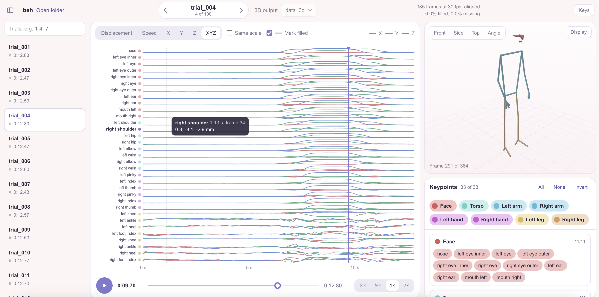
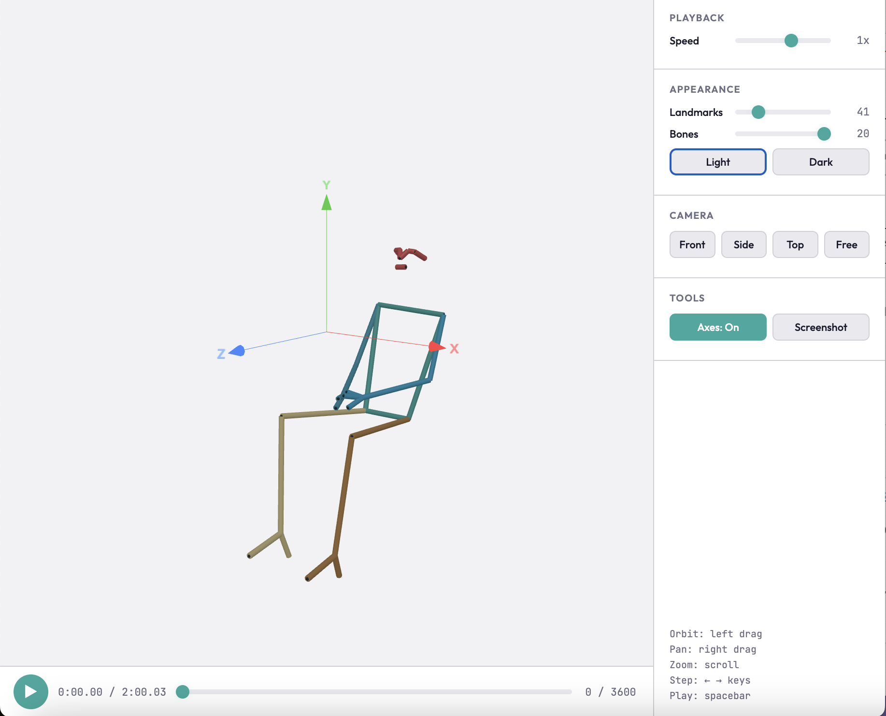
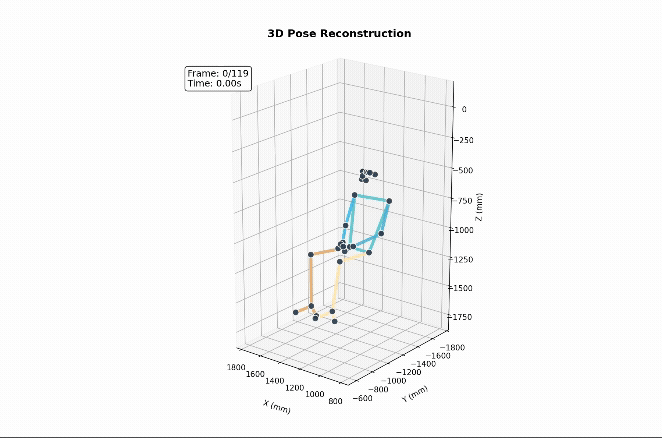

## Interactive viewers

Three interactive viewers are available for data inspection. 

**Data Viewer.** from `camkit3d.data_viewer`. Written in html.

```python
from camkit3d.data_viewer import data_viewer
data_viewer(all_data, fps=30) # all_data is (n_trials, frames, 33, 3) array
```

Or from terminal:
```bash
python -m camkit3d.data_viewer path_to_folder
```



data_viewer can load either raw data, individual datasets (single folder) or a folders of many datasets (many folders).

<div style="position:relative;padding-bottom:45.6%;height:0;overflow:hidden;border-radius:8px;margin:1em 0;">
  <iframe style="position:absolute;top:0;left:0;width:100%;height:100%;"
    src="https://www.youtube.com/embed/ygBtTQLNi3Q"
    title="CamKit3D Data Viewer"
    frameborder="0"
    allow="accelerometer; autoplay; clipboard-write; encrypted-media; gyroscope; picture-in-picture"
    allowfullscreen>
  </iframe>
</div>

**Pose Viewer.** from `camkit3d.viewer`. Written in html.

```python
from camkit3d.viewer import viewer
viewer(points_3d_filled, fps=30, output_path="pose_viewer.html")
```


**Matplotlib Viewer.** `interactive_pose_viewer(...)` from `camkit3d.analysis`.

```python
from camkit3d.analysis import interactive_pose_viewer
%matplotlib qt
interactive_pose_viewer(points_3d_filled, fps=30, initial_view="front")
```

## Animate to video

`animate_3d_pose(...)` exports the skeleton as a real-time video via FFmpeg, using the matplotlib viewer from above. The camera can be fixed or rotating. Overlays (floor, axes, frame number, timestamp) and output quality (DPI and bitrate presets) are configurable.

```python
animate_3d_pose(
    points_3d_filled,
    output_path="animations/pose_front.mp4",
    view_mode="custom",
    elevation=20, azimuth_start=128, rotation_speed=0,
    show_floor=False, show_axes=True,
    keypoint_size=70, line_width=4,
    fps=30, quality="high",
)
```


